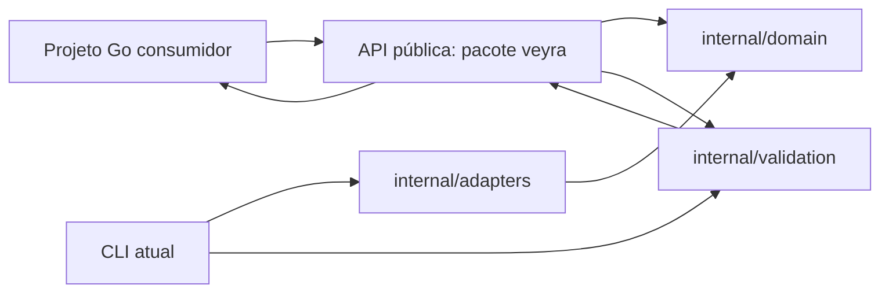

# Plano de Implementação: API Pública Go

## Objetivo

Permitir que outros módulos Go usem o VeyraSpec como biblioteca, preservando `internal/domain`, `internal/validation` e os adapters internos como detalhes de implementação.

O primeiro entregável será uma API pública pequena para construir uma Specification, fornecer um Trace e receber o resultado da validação. A API não carregará arquivos nem fará parsing de YAML.

## Arquitetura proposta

O pacote público ficará na raiz do módulo, com import path `github.com/wellfernandes/veyra-spec` e nome de pacote `veyra`.



A API pública converterá seus tipos para os tipos internos, chamará o domínio e o Validation Engine, e converterá o resultado de volta para tipos públicos. Nenhuma assinatura pública poderá expor tipos de `internal/`.

## Contrato inicial

A superfície pública inicial deve conter somente os tipos e operações necessários para validação sequencial:

* `SpecificationDefinition`, com ID, nome, descrição, estado inicial, estados, eventos, transições e estados finais.
* `State`, `Event` e `Transition`, definidos com campos públicos e identificadores como `string`.
* `NewSpecification(definition)`, que constrói e valida uma Specification pública opaca.
* `Trace`, com eventos observados e completude; `ObservedEvent` inclui ID e timestamp opcional.
* `TraceCompletenessUnknown`, `TraceCompletenessPartial` e `TraceCompletenessComplete`.
* `Validate(specification, trace)`, que retorna um `Result` público.
* Tipos públicos de resultado e diagnóstico que preservem estado alcançado, completude, violação de evento, violação de conclusão, eventos esperados e caminhos de transição.

Exemplo de uso pretendido:

```go
package example

import veyra "github.com/wellfernandes/veyra-spec"

func check() (bool, error) {
    specification, err := veyra.NewSpecification(veyra.SpecificationDefinition{
        ID:           "payment-flow",
        InitialState: "pending",
        States: []veyra.State{
            {ID: "pending", Name: "Pending"},
            {ID: "approved", Name: "Approved"},
        },
        Events: []veyra.Event{
            {ID: "payment_approved", Name: "Payment Approved"},
        },
        Transitions: []veyra.Transition{
            {ID: "approve-payment", From: "pending", Event: "payment_approved", To: "approved"},
        },
        FinalStates: []string{"approved"},
    })
    if err != nil {
        return false, err
    }

    result, err := veyra.Validate(specification, veyra.Trace{
        Completeness: veyra.TraceCompletenessComplete,
        ObservedEvents: []veyra.ObservedEvent{
            {EventID: "payment_approved"},
        },
    })
    if err != nil {
        return false, err
    }

    return result.Valid(), nil
}
```

O exemplo é ilustrativo; nomes e tipos definitivos devem ser aprovados na etapa de contrato antes da implementação.

## Etapas

### 1. Registrar a decisão de API pública

Criar ou atualizar um ADR para decidir o pacote público na raiz do módulo, o encapsulamento do domínio interno, o contrato de erros e a política inicial de estabilidade. Manter a primeira versão pequena e tratá-la como pré-`v1` enquanto for necessário validar o uso externo.

### 2. Definir os tipos públicos

Criar tipos independentes dos tipos internos. Usar strings para IDs, `time.Time` da biblioteca padrão para timestamps e um enum público para completude. A `Specification` construída deve ser opaca, sem campos internos exportados.

Documentar os campos obrigatórios, os valores de completude e a diferença entre consistência e conclusão.

### 3. Implementar a fachada

Implementar `NewSpecification` convertendo a definição pública para `domain.SpecificationDefinition` e delegando a validação estrutural a `domain.NewSpecification`.

Implementar `Validate` convertendo Specification e Trace públicos para os tipos internos, chamando `validation.Validate` e mapeando resultado, violações e caminhos de volta para tipos públicos. Copiar slices nas fronteiras para evitar que alterações do consumidor modifiquem estado interno.

Definir erros públicos estáveis e informativos. Preservar causas com wrapping quando aplicável, sem expor tipos de erro do pacote `internal`.

### 4. Provar o uso fora do módulo

Adicionar um teste consumidor em um módulo Go separado, usando o módulo local por `replace`. O teste deve importar apenas `github.com/wellfernandes/veyra-spec` e cobrir:

* Specification e Trace válidos;
* evento incompatível com a transição esperada;
* Trace completo que termina fora dos estados finais;
* completude parcial ou desconhecida;
* erros ao construir Specification inválida.

O teste externo deve compilar e passar sem importar `internal/domain`, `internal/validation` ou `internal/adapters`.

### 5. Documentar o uso

Adicionar ao README principal um exemplo mínimo de integração Go e atualizar o README pt-BR com conteúdo equivalente. Incluir a documentação GoDoc nos símbolos públicos, os comandos para executar o exemplo e esclarecer que YAML e CLI não fazem parte da API de validação inicial.

### 6. Validar e revisar o contrato

Executar `gofmt`, `go test ./...`, `go vet ./...` e o teste do módulo consumidor externo. Revisar se os tipos exportados, erros e diagnósticos são suficientes sem expor detalhes internos nem introduzir dependências externas.

## Fora do escopo desta etapa

* Parsing de YAML, leitura de arquivos, HTTP, PCAP, logs ou observabilidade pela API pública.
* Alterações na semântica FSM, no tratamento sequencial ou na completude.
* Actions, guards, concorrência, correlação ou restrições temporais.
* Frameworks de teste, integração automática com `testing.T` ou dependências adicionais.
* Migração do CLI para a nova fachada; essa decisão deve ser avaliada separadamente após o contrato público passar pelo teste consumidor.

## Critérios de aceite

* Um módulo Go independente consegue importar o pacote raiz e validar uma Specification e um Trace.
* Nenhum tipo de `internal/` aparece em assinatura pública.
* Os resultados públicos preservam os diagnósticos atuais sem alterar o Validation Engine.
* O exemplo Go da documentação compila e executa.
* Testes, `go vet` e teste externo passam.
* README em inglês e pt-BR descrevem o mesmo contrato.
